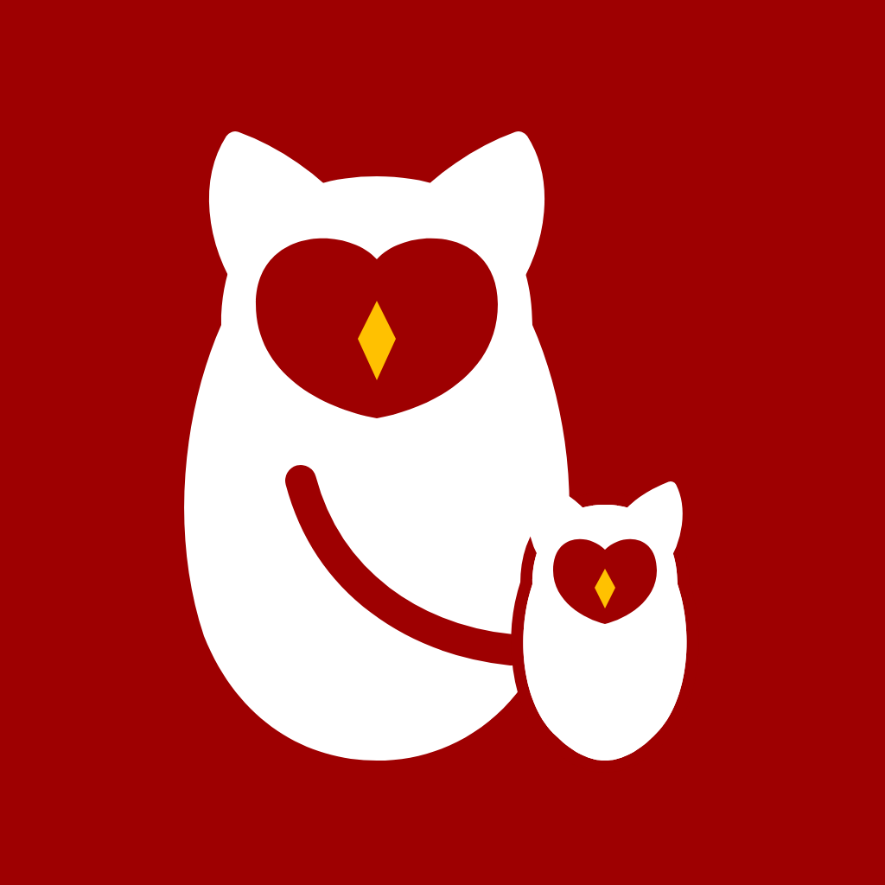
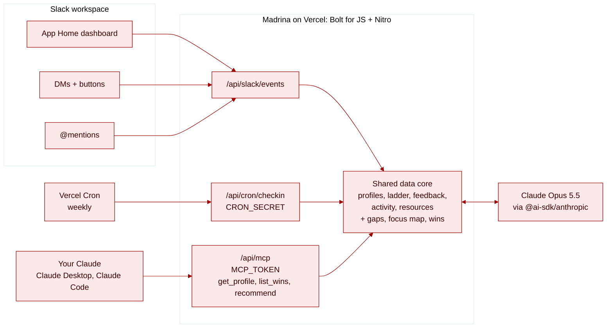

<div align="center">
  
  <h1>Madrina</h1>
</div>

A career coach in Slack for women software engineers, built on Claude. Madrina shows your path to your next level, catches when your work drifts away from what your manager said matters, and turns your wins into promo-ready bullets.

*Madrina* means godmother in Spanish: the woman who vouches for you.

## At a glance 🔎

| | |
| --- | --- |
| **What** | Slack app (App Home, DMs, @mentions) for career growth toward senior, Staff and Principal roles |
| **Goal** | Get more women promoted into senior engineering roles, and make the IC track (Staff, Principal) as normal a path as management |
| **Started at** | Code with Claude: Women in AI Hackathon, 2026-11-06. The hackathon version is archived at [FrancesCoronel/madrina](https://github.com/FrancesCoronel/madrina) |
| **Built by** | Frances Coronel |
| **Status** | Demo and side project. Not installed in the Latina Dev Slack workspace, and there is no launch date. Bringing it to [Latina Dev](https://latina.dev) members is an aspiration |
| **Data** | 100% synthetic for now. Ana Rivera, her manager Dana and everyone else in `data/` are made up. Real onboarding would have to replace them before anyone real uses it |
| **Where it lives** | `apps/madrina` in this repo, as a standalone project with its own dependencies (pnpm), linter (Biome) and deploy |

## The problem 📉

Women don't mostly leave tech because of childcare. They leave because they stop moving up.

- **Limited career advancement is the #1 reason women give for leaving tech jobs:** 28% in Indeed's 2018 US survey and 25% in the 2025 Lovelace Report (UK). Childcare comes in at 2 to 3%.
- **Women are 44% more likely to be asked to do non-promotable tasks** (research behind [*The No Club*](https://www.thenoclub.com)). Glue work keeps teams running and rarely shows up in a promo packet.
- **The career advice skews male.** Popular engineering newsletters and podcasts mostly feature men. On the Pragmatic Engineer podcast, fewer than 1 in 5 guests are women.

Promotion is an economic mobility lever: level sets pay, equity and who gets the next big project. Madrina sits where the work already happens, in Slack, and helps a woman see her gaps, protect her focus, get credit for her work and find advice from women who've done it.

## What Madrina does ✨

| Feature | What happens |
| --- | --- |
| 🏠 **App Home dashboard** | Current → target level and track, top 3 gaps (self-assessment vs. a ladder), one resource by a woman author matched to the biggest gap, wins logged, and the support system (mentor, sponsor, advocate, coach) shown as filled or empty |
| 🧭 **Weekly focus check** | Compares what her manager said matters (Gateway) with where her pull requests went (7 of 9 to Billing). If more than half went elsewhere, she gets a DM. It also points out that 6 of the 7 Billing asks came by DM and suggests moving them to a channel so the work is visible |
| ✍️ **Draft a note to my manager** | Claude drafts the note in the thread. Madrina never sends anything to her manager: she drafts, you decide |
| 🗺️ **Plan next week** | A Monday-to-Friday plan around the priority, each day tied to a Staff competency |
| 🏆 **Log a win** | Reply with one line. Claude rewrites it as a promo-ready bullet mapped to a ladder competency, and the App Home count updates |
| 💬 **Coach** | DM or @mention Madrina with a question. Answers use her profile, gaps, focus map and only the curated resource shelf |
| ⏰ **Cron** | Turn on weekly check-ins in App Home and a Vercel cron sends you the same focus check every Friday at 23:00 UTC (3 PM Pacific in winter). It goes to everyone who opted in, and you can turn it off any time |
| 🔌 **MCP connector** | Your own Claude can read your Madrina profile, gaps, wins and matched resources through `get_profile`, `list_wins` and `recommend`, so "am I on track for Staff?" gets answered from the same data as Slack |

The IC track and management are treated as equally valid. Madrina never infers anyone's gender.

## Architecture 🏗️



- **Slack app:** Bolt for JS on Nitro with `@vercel/slack-bolt`. Every Slack event, button click and command comes in at `/api/slack/events`.
- **Shared data core:** `server/lib/madrina/` reads the synthetic JSON in `data/`, computes gaps and the focus map, and keeps wins in memory (no database).
- **Claude:** `server/lib/ai/` calls Claude Opus 5.5 (medium effort) through `@ai-sdk/anthropic` to draft the manager note, plan the week, rewrite wins as structured bullets, and coach.
- **MCP connector:** `/api/mcp` serves the same data core over MCP Streamable HTTP as three read-only tools: `get_profile` (level, target, track, gaps, support system), `list_wins` (promo bullets with competencies) and `recommend` (only items from `data/resources.json`, matched to her gaps). It's guarded by a bearer token, `MCP_TOKEN`, which stands for the demo user. Code is in `server/api/mcp.ts` and `server/lib/mcp/`.

## Quick Start 🚀

You need Node 24+, pnpm, the [Slack CLI](https://docs.slack.dev/tools/slack-cli/), an Anthropic API key and a free [ngrok](https://ngrok.com) authtoken.

```bash
git clone https://github.com/Latina-Dev/latina-dev.git && cd latina-dev/apps/madrina
pnpm install
cp .env.example .env
```

Fill in `.env`: `ANTHROPIC_API_KEY`, `NGROK_AUTH_TOKEN`, `SLACK_SIGNING_SECRET` (from your app's Basic Information page), and `ANTHROPIC_WORKSPACE_ID` if your key isn't scoped to a workspace. Then:

```bash
slack login
slack run
```

`slack run` creates the app from `manifest.json`, installs it in the workspace you pick, and tunnels Slack events to your machine. Open Madrina's **Home** tab and click **Run my weekly check-in**.

To deploy, create a separate Vercel project for this folder (set **Root Directory** to `apps/madrina`; the Latina Dev website keeps its own project), set the same env vars plus `SLACK_BOT_TOKEN`, a long random `CRON_SECRET` and Redis credentials (add Upstash Redis from the Vercel Marketplace, which sets `KV_REST_API_URL` and `KV_REST_API_TOKEN`), and point the manifest URLs at `https://<your-app>.vercel.app/api/slack/events`.

The weekly cron checks in with everyone who clicked **Turn on weekly check-ins** in App Home. Those opt-ins, and each person's last check-in thread, are saved in Redis in production and in `.data/madrina` in local dev. Without Redis credentials a deployed Madrina only remembers them in memory, so the cron will usually find nobody. `MADRINA_DEMO_USER_ID` is optional: if set, that Slack member always gets the check-in too.

Wins and the profile are still the synthetic Ana demo data and are not saved per person yet.

### Connect your Claude 🔌

The MCP connector runs in the same server as the Slack app. Add `MCP_TOKEN` (any long random string) to `.env`, run `slack run`, and point your Claude at `http://localhost:3000/api/mcp`.

The commands below read the token from your shell, and `.env` is not loaded there, so export it first (use the same value as in `.env`):

```bash
export MCP_TOKEN=your-token-from-.env
```

**Claude Code:**

```bash
claude mcp add --transport http madrina http://localhost:3000/api/mcp --header "Authorization: Bearer $MCP_TOKEN"
```

**Claude Desktop:** add this to `claude_desktop_config.json` (Settings → Developer → Edit Config), put your token in place of `YOUR_MCP_TOKEN`, and restart Desktop. [`mcp-remote`](https://www.npmjs.com/package/mcp-remote) bridges Desktop to the local HTTP server.

```json
{
  "mcpServers": {
    "madrina": {
      "command": "npx",
      "args": ["-y", "mcp-remote", "http://localhost:3000/api/mcp", "--header", "Authorization: Bearer YOUR_MCP_TOKEN"]
    }
  }
}
```

Then ask: "Am I on track for Staff? What should I read next?"

**claude.ai:** custom connectors there sign in with OAuth and can't send a fixed bearer token, so claude.ai waits on per-user OAuth (see the roadmap).

⚠️ **Run it locally, in one process.** Wins live in memory. On Vercel, an MCP request can land on a different instance than the one that handled your Slack reply, and it will see no wins. Locally, `slack run` serves Slack and `/api/mcp` from one process, so a win you log in Slack shows up in `list_wins` right away. Persistent storage (on the roadmap) fixes this for deploys.

To check the route by hand:

```bash
curl -s http://localhost:3000/api/mcp -H "Authorization: Bearer $MCP_TOKEN" -H "Content-Type: application/json" -H "Accept: application/json, text/event-stream" -d '{"jsonrpc":"2.0","id":1,"method":"tools/call","params":{"name":"get_profile","arguments":{}}}'
```

Optional, for demos only: `scripts/seed-slack.ts` fills a test workspace with synthetic project channels and 1:1 threads from `data/slack-seed.json`, as a backdrop for the demo.

## Directory Structure 📁

```text
data/              synthetic profiles, ladder, manager feedback, PR activity, resources, Slack seed
server/api/        Slack events endpoint, the cron route and the MCP route
server/lib/ai/     Claude calls: voice, coach context, win rewriting
server/lib/madrina gaps, focus check, in-memory store
server/lib/mcp/    MCP server: get_profile, list_wins, recommend
server/lib/slack/  Block Kit for App Home, the check-in DM and replies
server/listeners/  Bolt listeners for events, messages, actions, commands
assets/            app icon and custom emoji
```

## Roadmap 🗺️

Madrina is meant to live in the Slack workspace you use for work, where your 1:1s, asks and pull requests already are. She speaks up while things are happening, when there's still time to change course. If Madrina ever comes to Latina Dev, it would be early access: members try it, help get it approved at their companies, and become the first pool of mentors and sponsors.

We'll measure success by how satisfied people are with Madrina and by their time to next promotion.

| | Idea | Why |
| --- | --- | --- |
| **Now** | Real multi-user onboarding: current level, target level, track, self-assessment | Real people can't be demo Ana |
| | Persistent per-user storage, plus "delete my data" | A long-running coach has to remember |
| | Privacy promise: your data is yours, never your manager's or HR's | Trust now, and the first thing a workspace admin will ask |
| | Satisfaction pulse, plus last promotion date at onboarding | Starts measuring success on day one |
| | A richer synthetic Ana, with a glue-work ask like shipping team swag | Gives the demo a story people remember |
| **Next** | Live glue-work flag in a private 1:1 channel with Madrina in it, plus a drafted hand-off reply | Catches the ask the moment it lands |
| | "Ask Madrina about this" message shortcut | Covers asks that land anywhere else |
| | Brag-doc export, wins grouped by competency | Wins turn into a promo packet |
| | Mentor, sponsor and coach matching across Latina.dev | Fills the support slots no single employer can |
| | Per-user OAuth for the MCP connector | Each member connects her own Claude, claude.ai included, and sees only her own data |
| | Real GitHub pull request signals | The focus check on real work instead of synthetic data |
| **Later** | Slack Marketplace listing and an admin approval kit | The way into work Slack |
| | Calendar and 1:1 note signals | What your manager actually said matters |
| | Time-to-promotion study against a sourced baseline | The impact claim |
| | Move from the deprecated template to Eve | Upkeep |

## Learnings 📝

Notes from the hackathon build are in the archived repo: [LEARNINGS.md](https://github.com/FrancesCoronel/madrina/blob/main/docs/LEARNINGS.md).

## Credits 🙏

- Started from Vercel's [Slack Agent Template](https://github.com/vercel-partner-solutions/slack-agent-template) (MIT), which is now deprecated in favor of [Eve Slack Agent](https://vercel.com/templates/eve/eve-slack-agent). Madrina keeps the template's Bolt + Nitro + Vercel setup and swaps its Workflow SDK agent and AI Gateway for direct Claude calls.
- The ladder in `data/ladder.json` is a simplified example inspired by public frameworks ([sdras/career-ladders](https://github.com/sdras/career-ladders), Dropbox). It's not any company's real ladder.
- Every resource Madrina recommends is by women who publicly identify as women: Tanya Reilly, Camille Fournier, Lara Hogan, Sarah Drasner, Cate Huston, Jean Hsu, Julia Evans, Charity Majors, Limor Bergman Gross, the authors of *The No Club*, and the Latina.dev community.

## License

MIT, same as the rest of this repo. See [LICENSE](../../LICENSE).
