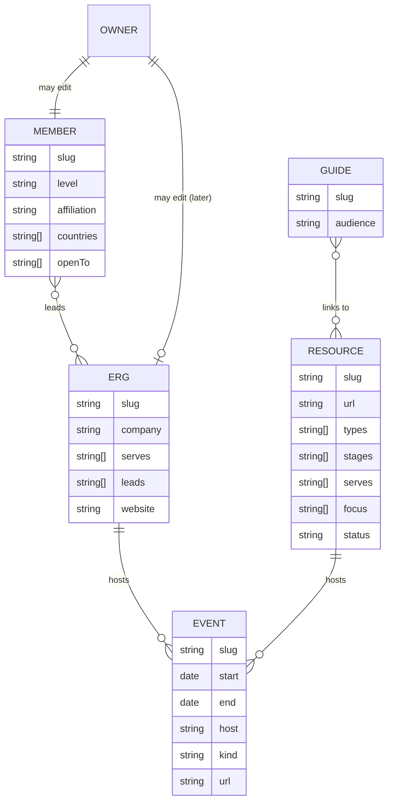
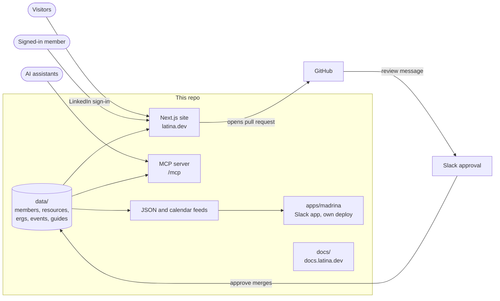

# Hub Plan

One community hub instead of three builds. This plan folds two older ideas, **The BLT Hub** (a directory of resources for Black and Latinx people in tech) and **ERG HQ** (a home for employee resource group leads), into latina.dev.

Status: **option A chosen on November 9, 2026.** Phase 1 is in progress.

## Where we are today

- Next.js app with no database. Content is files in this repo, checked by Zod schemas at build time.
  - Members: `data/members/*.md` (62 profiles)
  - Guides: `data/guides/*.md`
  - Resources: one TypeScript array in `lib/resources.ts` (49 entries in 9 groups)
- Members sign in with LinkedIn. A change becomes a pull request that an organizer approves in Slack. See [Member Sign-in](pages/member-sign-in.md).
- The same data feeds `/members.json`, `/resources.json` and the MCP server at `/mcp`.
- Madrina, the career coach Slack app, is moving into `apps/madrina` as its own deploy (#310).

The three ideas overlap more than they differ:

| Idea       | What it really is                              | Already on latina.dev?                 |
| ---------- | ---------------------------------------------- | -------------------------------------- |
| Latina.dev | People directory, resources, guides            | Yes                                    |
| BLT Hub    | Resources directory with richer filters        | Mostly. `/resources` is the same thing |
| ERG HQ     | ERG directory, events, playbooks for ERG leads | No                                     |

## The decision: one brand or three

### Option A: one site, one brand (chosen)

Everything lives on latina.dev. BLT Hub becomes a better `/resources`. ERG HQ becomes `/ergs` and `/events`, scoped to Latinx ERGs to start.

- **For:** one build, one design system, one domain collecting all the search traffic, one MCP server. Each phase ships something useful in an evening or two.
- **Against:** a Black ERG lead or a non-Latina visitor won't look for this on latina.dev. The erghq.com and BLT Hub names stay parked.

### Option B: one codebase, three front doors

One Next.js app serves latina.dev, a BLT Hub domain and erghq.com. Each domain is a themed, filtered view of the same content.

- **For:** keeps all three brands and the wider audiences.
- **Against:** three navs, three themes, three sets of SEO and three half-empty sites to fill, on about five hours a week. Host-based routing also touches every page, the sitemap, auth callbacks and the MCP server.

### Decision

**Option A, built so option B stays cheap.** The content model below tags every item with who it serves, and never hardcodes "Latina" into a schema. If a second brand earns its keep later, it is a filter and a theme, not a rewrite.

## Keep content in files, not a database

A database (Postgres, a CMS) is the usual next step for a hub. It isn't worth it yet:

- The sign-in → pull request → Slack approval pipeline already gives review, history and rollback for free.
- Volume is tiny: tens of changes a month, not thousands.
- A database adds hosting, backups, an admin screen and private data to look after.

Revisit when submissions pass about 20 a week, or when something must stay private (budgets, member-only content). Until then, the work is to **make the existing pipeline handle more than profiles**.

## Content model

Each content type is a folder of Markdown files with frontmatter, one file per item, checked by a Zod schema. One file per item keeps pull requests small and free of merge conflicts.

| Type      | Folder            | New? | Notes                                                                                                                                                                  |
| --------- | ----------------- | ---- | ---------------------------------------------------------------------------------------------------------------------------------------------------------------------- |
| Members   | `data/members/`   | No   | Unchanged                                                                                                                                                              |
| Resources | `data/resources/` | Move | From `lib/resources.ts`. Adds the BLT Hub fields: `types` (community, job board, podcast…), `stages` (K-12, college, workplace, founders), `serves`, `focus`, `status` |
| ERGs      | `data/ergs/`      | Yes  | Name, company, who it serves, public link, leads (member slugs)                                                                                                        |
| Events    | `data/events/`    | Yes  | Conferences, heritage months, open ERG events. Feeds `/events.ics`                                                                                                     |
| Guides    | `data/guides/`    | No   | Adds `audience` so ERG lead playbooks sit beside the existing guides                                                                                                   |
| Owners    | `data/owners/`    | No   | Later: `data/owners/<type>/<slug>.txt` so an ERG lead can own an ERG page                                                                                              |

The nine resource groups on `/resources` today become saved filters with their own copy, so every existing URL keeps working.

## Routes

| Route                              | Status    | What it shows                                                             |
| ---------------------------------- | --------- | ------------------------------------------------------------------------- |
| `/`                                | Change    | Three doors: find people, find resources, run an ERG                      |
| `/members/…`                       | Unchanged |                                                                           |
| `/resources`, `/resources/[group]` | Change    | Same URLs, plus filters by stage, type and who it serves                  |
| `/ergs`, `/ergs/[slug]`            | New       | ERG directory and pages                                                   |
| `/ergs/start`                      | New       | Playbook for starting and running an ERG                                  |
| `/events`, `/events.ics`           | New       | Calendar anyone can subscribe to                                          |
| `/guides/[slug]`                   | Unchanged |                                                                           |
| `/profile`                         | Unchanged | Later joined by `/submit/resource`, `/submit/erg`, `/submit/event`        |
| `/mcp`                             | Change    | Adds `search_ergs` and `search_events`, and filters on `search_resources` |
| `/ergs.json`, `/events.json`       | New       | Same pattern as `/members.json`                                           |

## How the pieces fit

- **Sign-in:** stays LinkedIn only, with ownership as files in `data/owners`. No roles table.
- **MCP server:** reads the same folders, so every new content type gets a search tool for the cost of a schema.
- **Madrina:** stays its own app and reads the public JSON feeds, never the site's code. Either side can change without breaking the other.
- **Docs:** stay on docsify. Each new content type gets a contributor page.

## Phases

Each phase ships on its own and leaves the site better even if the next one never happens.

1. **Resources become data.** Move `lib/resources.ts` into `data/resources/`, add the BLT Hub fields, bring in the published BLT Hub entries from Notion, add filters to `/resources` and to the MCP tool. No URL changes.
2. **ERGs.** `data/ergs/`, the `/ergs` directory, the first ERG lead playbook, and the three-door home page.
3. **Events.** `data/events/`, `/events`, the calendar feed, heritage months.
4. **Submissions for everything.** Resource, ERG and event forms that reuse the profile pipeline, and owner files per content type.

## Parked on purpose

These were in the original ERG HQ idea. Each is a product of its own, not a page on a community site:

- ERG management tools (OKRs, budgets, Slack announcements)
- Paid tiers
- A community forum
- A course on launching an ERG
- Separate BLT Hub and ERG HQ sites (option B)
- A database

## Decisions

Made by Frances on November 9, 2026:

1. **Option A.** One site, one brand.
2. **The ERG HQ product pieces stay parked:** management tools, paid tiers, forum and course.
3. **Resources are for Latinas.** A BLT Hub entry comes over only if it serves Latinas: Latina, Latinx, or women of color broadly. Entries that only serve other groups are left out.
4. **`/ergs` starts with Latinx ERGs only.**
